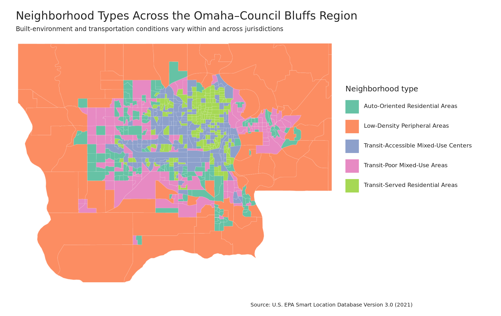
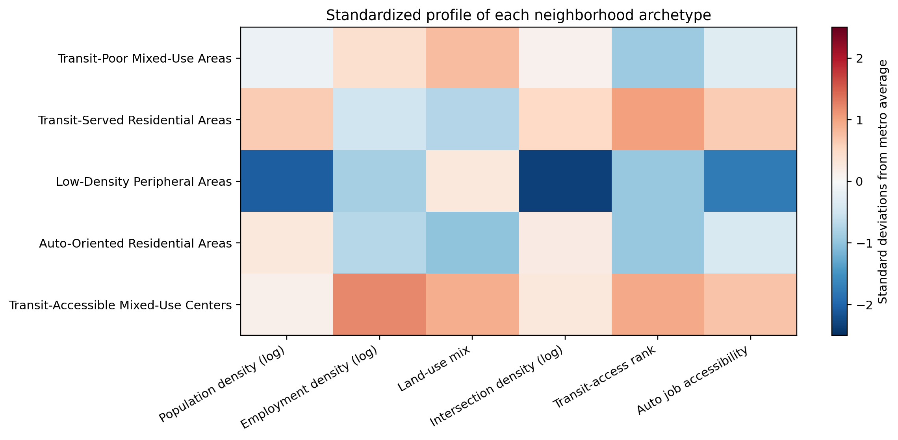
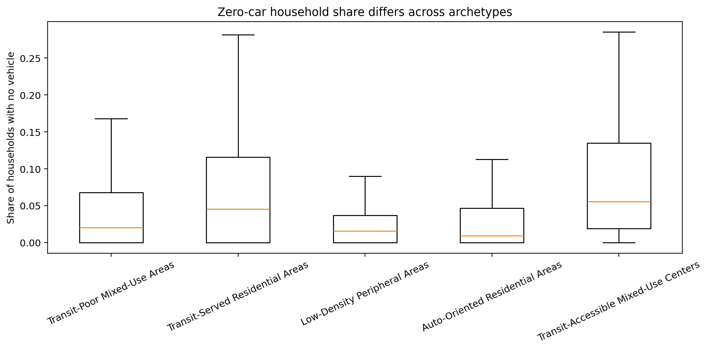

```{r setup, include=FALSE}
# Global chunk setup for consistent output and reproducible figures
knitr::opts_chunk$set(
  echo = FALSE,          # Show code chunks by default
  warning = FALSE,      # Suppress warnings in final report
  message = FALSE,      # Suppress library loading messages
  fig.align = "center", # Center all plots
  fig.width = 7,        # Standard plot width
  fig.height = 4.5       # Standard plot height
)

# Load core packages required for the project
library(tidyverse)
library(knitr)
```

# Methods

## K-Clustering Neighborhood Archetypes

The analysis classified 727 census block groups in Douglas and Sarpy Counties in Nebraska and Pottawattamie County in Iowa. Six measures from the U.S. Environmental Protection Agency's Smart Location Database were used: population density, employment density, the balance between employment and households, street-intersection density, transit access, and automobile access to regional employment. Highly skewed density measures were transformed, and all six measures were standardized so that variables measured in different units contributed comparably.

The raw distance-to-transit measure was not used because 365 block groups contain the EPA code for no reported transit coverage. Instead, the analysis used the EPA's ranked transit-access measure, which explicitly gives unserved areas the lowest rank. The percentage of households without a vehicle was excluded when creating the neighborhood groups and was examined afterward. This keeps vehicle availability independent from the characteristics used to form the groups.

K-means solutions containing two through eight neighborhood types were compared. Five groups were selected because they preserved useful differences in residential character, employment activity, transit availability, and job accessibility that were lost in a simpler urban-versus-peripheral split. Reliability was assessed by restarting the model 50 times, refitting it to 100 independently selected 80% samples, comparing it with a different clustering method, and repeating the analysis with alternative combinations of neighborhood characteristics. These checks evaluate whether the broad neighborhood patterns depend on one random model run or one narrow selection of variables.

The share of households without a vehicle was compared across the five neighborhood types only after the types were created. This analysis describes association; it does not establish that neighborhood form causes households to own fewer vehicles. Cluster assignments were then joined to 2019 Census block-group boundaries to produce the regional planning map.

The five-group pattern remained highly consistent when the model was restarted from different initial positions and repeatedly fit to different 80% samples. A second clustering method recovered a broadly similar regional structure. Some block groups changed categories when the selected neighborhood characteristics were substantially altered, which is expected because neighborhood types are summaries rather than permanent boundaries.


# Results

## Neighborhood Archetypes

Can census block groups in the Omaha-Council Bluffs region be organized into useful neighborhood types based on density, land-use mix, street connectivity, transit access, and employment accessibility? Once these neighborhood types are identified, where are they located, how does vehicle availability differ among them, and how can the results help planners identify different transportation needs across the region?

```{r archetypes-map, echo=FALSE, fig.align="center", out.width="100%",fig.cap="Five neighborhood archetypes across the three-county Omaha-Council Bluffs study area."}

```

The map is the central data product because it turns six separate neighborhood measures into a geographic planning story (Figure \@ref(fig:archetypes-map)). Low-density peripheral areas dominate the outer portions of the study region, while transit-accessible mixed-use centers and transit-served residential areas are concentrated in the developed urban core. Auto-oriented residential areas and transit-poor mixed-use areas form important transition zones between these conditions. Transportation needs therefore do not follow city or county boundaries neatly; several neighborhood contexts occur within the same jurisdiction.

This matters because a single regional strategy would treat unlike places as though they face the same problem. Peripheral areas may require targeted or flexible service because of long distances and low density. Transit-poor mixed-use areas may be promising candidates for improved fixed-route connections because housing and destinations are already present but transit access remains weak. Transit-accessible centers should be protected from service reductions because they combine destinations, transit access, and larger shares of households without vehicles.

**What distinguishes the five neighborhood types**
```{r neighborhood-distinguishes, echo=FALSE, fig.align="center", out.width="100%", fig.cap="Characteristics distinguishing the five neighborhood archetypes. Values above zero indicate that a neighborhood type is above the regional average for that characteristic; values below zero indicate that it is below the regional average."}

```

The five types have different planning implications (Figure \@ref(fig:neighborhood-distinguishes)):

1. **Transit-poor mixed-use areas** contain a useful mix of housing and employment but have comparatively weak transit access.
2. **Transit-served residential areas** are relatively dense residential neighborhoods with better transit access but fewer nearby employment destinations.
3. **Low-density peripheral areas** have low population and employment density, limited street connectivity, weak transit access, and lower regional job accessibility.
4. **Auto-oriented residential areas** contain moderate-to-high residential density but relatively little employment, limited land-use mix, and weak transit access.
5. **Transit-accessible mixed-use centers** combine employment, mixed land uses, street connectivity, transit access, and strong access to regional jobs.

These classifications help planners identify locations for more detailed investigation; they do not prescribe investments by themselves. For example, a mixed-use area with weak transit may be a stronger candidate for route or frequency improvements than a sparsely developed peripheral location. Current service, ridership, costs, and community input would still be needed before making a decision.

**Vehicle availability differs across neighborhood contexts**

```{r vehicle-availability, echo=FALSE, fig.align="center", out.width="100%", fig.cap="Distribution of the share of households without a vehicle in each neighborhood archetype. The highest typical shares occur in the two types with stronger transit access."}

```

Households without vehicles are not distributed evenly across the five neighborhood types. Transit-accessible mixed-use centers have the largest average share of households without a vehicle, approximately 9.7%, followed by transit-served residential areas at approximately 8.3%. The corresponding averages are approximately 4.8% in transit-poor mixed-use areas, 3.2% in auto-oriented residential areas, and 2.8% in low-density peripheral areas (Figure \@ref(fig:vehicle-availability)).

The clearest equity finding is that car-free households are more concentrated in the two neighborhood types with stronger transit access. This suggests that existing transit is broadly aligned with many households that are likely to depend on it. However, regional averages do not prove that service is sufficient, frequent, affordable, or well connected to needed destinations. They can also hide individual block groups where car-free households face weak access. The archetype map should therefore be used with the team's transit and employment-accessibility screening to identify specific places where dependence and access may not align.

For planners, this finding supports two complementary actions. First, maintain reliable service in transit-accessible centers and transit-served residential areas, where reductions could disproportionately affect households without vehicles. Second, examine transit-poor mixed-use areas for feasible improvements because they already contain residents and destinations that may support stronger service.

The broad geographic pattern is stable enough for regional screening, but individual labels should not be treated as final investment decisions. Planners should combine the archetypes with current transit schedules, ridership, travel times, project costs, and community input.


