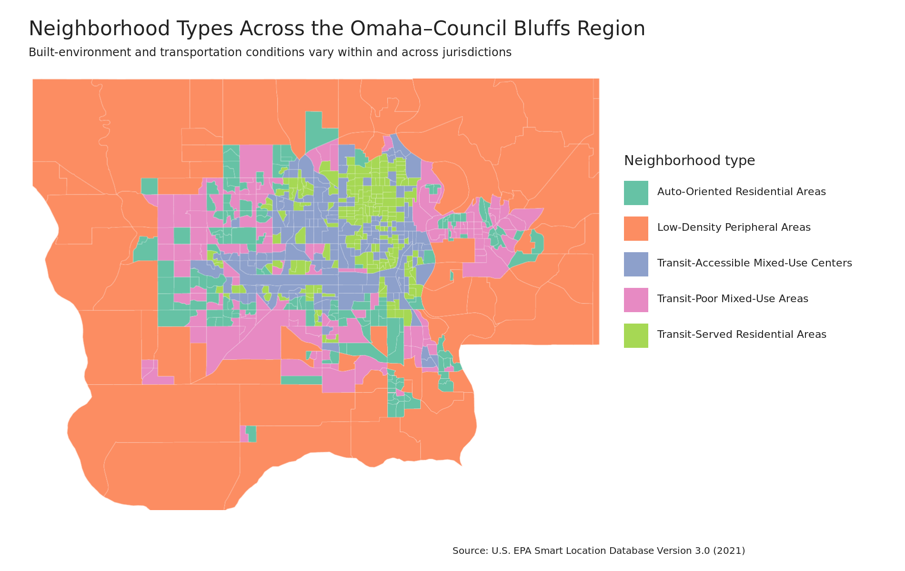
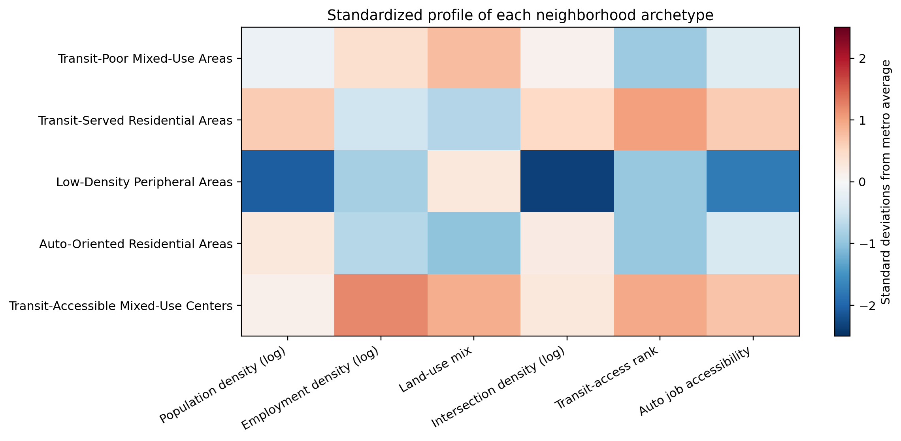
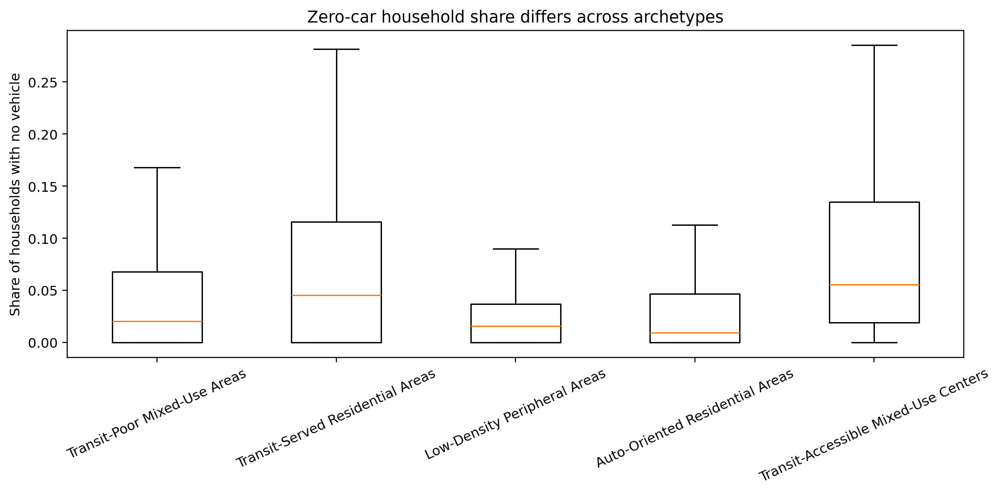

<style>
.title, .author, .date {
  text-align: center;
}
</style>

```{r setup, include=FALSE}
# Global chunk setup for consistent output and reproducible figures
knitr::opts_chunk$set(
  echo = FALSE,          # Show code chunks by default
  warning = FALSE,      # Suppress warnings in final report
  message = FALSE,      # Suppress library loading messages
  fig.align = "center", # Center all plots
  fig.width = 7,        # Standard plot width
  fig.height = 4.5       # Standard plot height
)

# Load core packages required for the project
library(tidyverse)
library(knitr)
```

# Introduction

For most American households, car ownership is often the single largest expense after housing. It is a financial reality that can become severe when urban planning mandates vehicle ownership. In transit-poor and sprawling neighborhoods, owning multiple automobiles is rarely a luxury, but instead a compulsory toll required to access basic employment, education, and healthcare. This forced reliance acts as a pervasive "car tax," disproportionately impacting low-income families through auto loans, insurance, and maintenance simply to participate in the regional economy. When infrastructure fails to provide viable transportation alternatives, vehicle ownership ceases to represent personal freedom and instead becomes an enforced mechanism of inequality.

Urban equity is the idea that all people, regardless of income, race, or geographic location, deserve fair and affordable access to the opportunities and public infrastructure that enable socio-economic mobility. In transportation planning, urban equity is crucial because mobility directly dictates life outcomes. Without reliable transportation to employment centers, quality healthcare, and education, marginalized communities face significant barriers to escaping poverty.

A central driver of urban inequity is the transit gap: the disparity between where public transit dependent populations live and where high-quality and frequent public transportation service is actually provided. Bridging the transit gap is important because when public transit options fall short of community needs, low-income households are either forced into high-cost vehicle ownership or left isolated from economic opportunities. Closing this gap ensures that low-income residents can reliably reach jobs and essential services.

The transit gap has a long research history. It began in 1968, when John F. Kain proposed the Spatial Mismatch Hypothesis, which describes a physical separation between where low-income and minority workers live and where entry-level jobs are located. [@kain1968housing] His study focuses on how residential segregation combined with the suburbanization of entry-level jobs creates a spatial disconnect where physical distance and inadequate transit drive systemic unemployment.

Thirty years later, Litman focuses on the difference between horizontal equity (fair allocation of resource) and vertical equity (allocating resources to compensate for socio-economic disadvantage). [@litman2002evaluating] The work demonstrates how failing to close the transit gap exacerbates income inequality and social isolation. Grengs analyzes the transit gap in Detroit where he demonstrates that public transit riders face severe access penalties compared to car owners. [@grengs2010job] He argues that expanding transit access is far more effective for urban equity than continuing to subsidize auto-oriented development.

In 2013, Jiao and Dillivan coin the term “Transit Desert”. [@jiao2013transit] They formulate a spatial methodology comparing transit-dependent populations (demand) with public transit infrastructure (supply) across urban neighborhoods. The work shows that the areas with the highest transit needs often receive disproportionately low transit investment, exacerbating urban inequality. Blumenberg and Pierce focus on the intersection of household poverty, forced vehicle ownership, and transit dependence. [@blumenberg2014multimodal] They show that while automobiles significantly expand job access, the financial strain of maintaining a car in transit-poor areas often offsets economic gains, reinforcing the need for reliable public transit alternatives.

The Omaha-Council Bluffs metropolitan region has historically evolved around low-density and car-centric suburban growth, requiring most households to own at least one vehicle. The decline of early streetcar networks coupled with highway expansion encouraged suburbanization, leaving local transportation infrastructure structured for private automobile ownership. Consequently, the transit gap presents a major hurdle for urban equity. With major commercial corridors, healthcare facilities, and industrial employment hubs being widely spread, a severe transit gap places a disproportionate financial burden on low-income residents, isolates non-driving populations, and limits regional socio-economic mobility. 

This study investigates the transit gap in the Omaha-Council Bluffs metropolitan area through four distinct analytical lenses: 1) Clustering neighborhoods into archetypes; 2) Determining drivers of auto dependence through prediction models; 3) Evaluating employment access; and 4) comparing the differences between Omaha and Council Bluffs. The intention is to better understand the transit gap, identify the areas it impacts the most, and make strategic policy recommendations for city planners and regional managers such as the Metropolitan Area Planning Agency (MAPA) and Metro Transit.

The paper is divided into the following sections: a description of the Smart Location Database used for analysis; Methods defining experimental and statistical models; Results stating the findings, their significance, and policy recommendations; a Conclusion; and a Final Project Outline detailing how to further discovery and tools creation.

# Smart Location Database

The EPA Smart Location Database (SLD) is a nationwide and open-source geographic resource developed by the U.S. Environmental Protection Agency. [@epa_sld_2021] It is designed to measure and analyze built environment variables across census block groups. Designed for urban planners, transportation modelers, and policy researchers, the SLD provides standardized indicators structured around the "Five D's" of urban planning: Density, Diversity, Design, Destination Accessibility, and Distance to Transit. By aggregating different spatial metrics including gross residential density, street intersection frequency, job-housing mix, transit service availability, and regional job accessibility into a single dataset, the database allows analysts to evaluate how neighborhood structure shapes regional travel behavior.

The primary aim of the Smart Location Database is to help create sustainable, resilient, and transit-supported communities by providing an empirical foundation for land-use and transportation decisions. By offering accessible and consistent spatial indicators across all U.S. metropolitan regions, the database empowers researchers to predict travel demand, evaluate vehicle miles traveled, model household auto ownership, and identify areas with pronounced walkability or transit accessibility gaps. Ultimately, the SLD seeks to support multi-modal planning initiatives that lower greenhouse gas emissions, enhance urban mobility options, and inform equitable land development strategies across diverse regional areas.

The SLD is an ideal dataset for our study to analyze the presence and impact of transit gaps in the Omaha-Council Bluffs metropolitan area. The data is detailed, high-quality, and compiled as recently as 2021. With 90 features, it provides a comprehensive view of the built environment, socio-economic conditions, and accessibility factors that influence urban equity in the region. The rich variable set permits us to determine unique neighborhood archetypes, predict the primary influences of compulsory automobile ownership, evaluate employment accessibility, and compare the differences between Omaha and Council Bluffs.

The SLD is a vast dataset consisting of 220,740 rows with a size of almost 200 MB. Since the Omaha-Council Bluffs metropolitan area resides in Douglas, Sarpy, and Pottawattamie counties, the tigris R-package was utilized to identify the specific census blocks of the region. The rows matching these blocks were extracted and placed in their own file with a final 728 rows and size of roughly 663 KB. This smaller, focused dataset allowed for more efficient analysis of the metropolitan area.

The SLD is a rich dataset of 90 unique features. We focus on a subset that is relevant to our analysis of urban equity in the Omaha-Council Bluffs Metro area. The utilized variables are:

- **Automobile Job Accessibility Index (D5CRI):** Relative accessibility to regional employment by automobile. Scale: 0 = Lowest regional job accessibility; 1 = Highest regional job accessibility.
- **Census Block Group Identifier (GEOID):** A unique 12-digit Federal Information Processing Series (FIPS) code that uniquely identifies each Census Block Group nationwide.
- **Distance to Nearest Transit Stop (D4A):** Distance (in meters) from the block group population centroid to the nearest transit stop.
- **Employment & Household Mix (D2A_EPHHM):** Balance between employment activity and households within the block group. Higher values indicate a more even mix of jobs and households.
- **Employment & Housing Mix (D2B_E8MIX):** Balance between housing units and employment opportunities within the block group. Scale: 0 = Pure residential or pure commercial; 1 = Highly balanced mix of jobs and housing.
- **Employment Accessibility by Automobile (D5AR):** Travel-time-weighted access to employment by automobile, used as descriptive context.
- **Employment Accessibility by Transit (D5BR):** Travel-time-weighted access to employment by public transit, based on modeled transit schedules. Missing values do not mean zero transit service.
- **Employment Diversity / Jobs-to-Household Ratio (D2A_JPHH):** Ratio of jobs to households within the block group, capturing localized mixed-use balance.
- **Gross Employment Density (D1C):** Total jobs per acre of unprotected land. Higher values indicate higher concentrations of employment.
- **Gross Population Density (D1B):** Total population per acre of unprotected land. Higher values indicate greater population concentration.
- **Gross Residential Density (D1A):** Housing units per acre of unprotected land. Higher values indicate denser residential settlement.
- **Households (HH):** Total number of households in the Census block group.
- **Households Without a Vehicle (AutoOwn0):** Number of households reporting no vehicle available.
- **Median Household Income (MedIncome):** Census block group median household income in USD.
- **National Walkability Index (NatWalkInd):** Composite index evaluating overall pedestrian friendliness based on density, diversity, and design. Scale: 1 = Least Walkable (Auto-Dependent Car Suburb); 20 = Most Walkable (Pedestrian-Oriented Urban Core).
- **Peak-Period Transit Service Frequency (D4C):** Scheduled transit service frequency during the weekday evening peak period for qualifying nearby stops.
- **Percentage Low-Income Households (Pct_LowInc):** Proportion of households living below the regional low-income threshold.
- **Street Intersection Density, Total (D3A):** Total multi-leg street intersections per square mile of unprotected land.
- **Street Intersection Density (D3B):** Pedestrian-oriented street grid density (intersections with 3 or more legs per square mile). Scale: Higher values reflect a tighter, more interconnected street grid conducive to walking.
- **Transit Access Rank (D4A_Ranked):** Ranked measure of proximity to transit, with higher values indicating better transit access; block groups without reported transit coverage receive the lowest rank.
- **Transit Regional Job Accessibility (D5CR):** Total regional employment accessible within a 45-minute commute via public transit.
- **Transit Service Density (D4D):** Peak-period transit service frequency normalized by block group area.
- **Zero-Car Household Share (Pct_AO0):** Proportion of households with no available vehicle. This variable was compared across neighborhood archetypes after clustering and was not used to create the clusters.

It should be noted that the SLD makes use of sentinel values for missing data. For example, the Distance to Transit Stop feature uses the value “-99999” for census blocks that have no regional transit. These values are handled by omission or recoding based on the analysis utilized as clearly stated in the Methods section.

# Methods

## K-Clustering Neighborhood Archetypes

The analysis classified 727 census block groups in Douglas and Sarpy Counties in Nebraska and Pottawattamie County in Iowa. Six measures from the U.S. Environmental Protection Agency's Smart Location Database were used: population density, employment density, the balance between employment and households, street-intersection density, transit access, and automobile access to regional employment. Highly skewed density measures were transformed, and all six measures were standardized so that variables measured in different units contributed comparably.

The raw distance-to-transit measure was not used because 365 block groups contain the EPA code for no reported transit coverage. Instead, the analysis used the EPA's ranked transit-access measure, which explicitly gives unserved areas the lowest rank. The percentage of households without a vehicle was excluded when creating the neighborhood groups and was examined afterward. This keeps vehicle availability independent from the characteristics used to form the groups.

K-means solutions containing two through eight neighborhood types were compared. Five groups were selected because they preserved useful differences in residential character, employment activity, transit availability, and job accessibility that were lost in a simpler urban-versus-peripheral split. Reliability was assessed by restarting the model 50 times, refitting it to 100 independently selected 80% samples, comparing it with a different clustering method, and repeating the analysis with alternative combinations of neighborhood characteristics. These checks evaluate whether the broad neighborhood patterns depend on one random model run or one narrow selection of variables.

The share of households without a vehicle was compared across the five neighborhood types only after the types were created. This analysis describes association; it does not establish that neighborhood form causes households to own fewer vehicles. Cluster assignments were then joined to 2019 Census block-group boundaries to produce the regional planning map.

The five-group pattern remained highly consistent when the model was restarted from different initial positions and repeatedly fit to different 80% samples. A second clustering method recovered a broadly similar regional structure. Some block groups changed categories when the selected neighborhood characteristics were substantially altered, which is expected because neighborhood types are summaries rather than permanent boundaries.

## Auto Dependency Prediction and Evaluation

**Data Pre-Processing**

```{r, echo=FALSE}
# ==============================================================================
# EPA Smart Location Database - Preprocessing & Pipeline Setup
# ==============================================================================

library(tidyverse)
library(tidymodels)
library(sf)
library(data.table)
library(tigris)
library(dplyr)
library(knitr)
library(kableExtra)

# Set seed for reproducible splits and cross-validation
set.seed(402)

# Fetch census block geometries for future code chunks
options(tigris_use_cache = TRUE)

# Fetch Census Block Groups for both NE and IA, then combine
omaha_metro_shapes <- map_dfr(c("NE", "IA"), function(st) {
  block_groups(state = st, year = 2020, cb = TRUE)
}) %>%
  filter(
    (STATEFP == "31" & COUNTYFP %in% c("055", "153")) | # Douglas (055) & Sarpy (153), NE
    (STATEFP == "19" & COUNTYFP == "155")              # Pottawattamie (155), IA
  ) %>%
  select(GEOID)
# ------------------------------------------------------------------------------
# 1. Data Loading & Flexible Preprocessing
# ------------------------------------------------------------------------------

# Read raw dataset
raw_data <- read_csv("EPA_SDL_OmahaCouncilBluffs.csv", show_col_types = FALSE)

# Clean and transform features
clean_data_juicio <- raw_data %>%
  # Filter out non-residential block groups using 'HH' column
  filter(!is.na(HH) & HH > 0) %>%
  
  # Construct clean 12-digit GEOID and grouping variables
  mutate(
    STATEFP     = str_pad(as.character(STATEFP), 2, "left", "0"),
    COUNTYFP    = str_pad(as.character(COUNTYFP), 3, "left", "0"),
    TRACTCE     = str_pad(as.character(TRACTCE), 6, "left", "0"),
    BLKGRPCE    = str_pad(as.character(BLKGRPCE), 1, "left", "0"),
    GEOID       = paste0(STATEFP, COUNTYFP, TRACTCE, BLKGRPCE),
    Tract_FIPS  = factor(paste0(STATEFP, COUNTYFP, TRACTCE)),
    County_FIPS = factor(paste0(STATEFP, COUNTYFP))
  ) %>%
  
  # Compute Target Variable: Average Vehicles per Household
  mutate(
    Auto0  = coalesce(pick(any_of(c("AutoOwn0", "AUTOOWN0")))[[1]], 0),
    Auto1  = coalesce(pick(any_of(c("AutoOwn1", "AUTOOWN1")))[[1]], 0),
    Auto2p = coalesce(pick(any_of(c("AutoOwn2p", "AUTOOWN2P")))[[1]], 0),
    
    Avg_Vehicles = ((0 * Auto0) + (1 * Auto1) + (2 * Auto2p)) / HH
  ) %>%
  
  # Recode SLD Sentinels (-99999 / NA) and safe fallback defaults
  mutate(
    # Non-serviced transit areas capped at 3,000m walk-shed limit
    D4A = ifelse(is.na(D4A) | D4A < 0, 3000, D4A),
    D4D = ifelse(is.na(D4D) | D4D < 0, 0, D4D),
    
    NatWalkInd = if ("NatWalkInd" %in% names(.)) NatWalkInd else 1,
    MedIncome  = if ("MedIncome" %in% names(.)) MedIncome else if ("MEDINCOME" %in% names(.)) MEDINCOME else NA_real_,
    
    # Compute Demographic Equity Ratio (No target leakage)
    Transit_Disparity = MedIncome / (D4A + 1)
  ) %>%
  
  # Select model features, target, and spatial ID keys
  select(
    GEOID, Tract_FIPS, County_FIPS,
    Avg_Vehicles,
    any_of(c(
      "D1A", "D1C", "D2A_JENT", "D2B_E8MIX", "D3B", 
      "D4A", "D4D", "MedIncome", "Pct_LowInc", "NatWalkInd"
    )),
    Transit_Disparity
  )

# ------------------------------------------------------------------------------
# 2. Train / Test Split & Spatial Group Cross-Validation
# ------------------------------------------------------------------------------

# Initial 80/20 train/test split stratified by County FIPS
data_split <- initial_split(clean_data_juicio, prop = 0.80, strata = County_FIPS)
train_data <- training(data_split)
test_data  <- testing(data_split)

# Spatial Cross-Validation: Group K-Fold by Census Tract (Tract_FIPS)
# Prevents spatial autocorrelation leakage across adjacent blocks
spatial_cv_folds <- group_vfold_cv(train_data, group = Tract_FIPS, v = 5)

# ------------------------------------------------------------------------------
# 3. Feature Engineering Recipe (`tidymodels`)
# ------------------------------------------------------------------------------

prep_recipe <- recipe(Avg_Vehicles ~ ., data = train_data) %>%
  # Retain spatial tracking columns as IDs
  update_role(GEOID, Tract_FIPS, County_FIPS, new_role = "ID") %>%
  step_impute_median(all_numeric_predictors()) %>%
  step_nzv(all_numeric_predictors())

# Verify preprocessed structure
prepped_recipe_fit   <- prep(prep_recipe, training = train_data)
X_train_preprocessed <- bake(prepped_recipe_fit, new_data = NULL)
X_test_preprocessed  <- bake(prepped_recipe_fit, new_data = test_data)

#cat("Preprocessing Complete!\n")
#cat("Training Rows: ", nrow(X_train_preprocessed), "\n")
#cat("Testing Rows:  ", nrow(X_test_preprocessed), "\n")
#cat("CV Folds:      ", length(spatial_cv_folds$splits), "\n")

# Preview prepared data structure
#glimpse(X_train_preprocessed)

```

Data preprocessing began with cleaning, filtering, and recoding attribute data from the Smart Location Database alongside spatial geometries from the U.S. Census Bureau. The target dependent variable for all models was defined as average household vehicle ownership (Avg_Vehicles), measured at the Census Block Group level. The transit proximity variable (D4A), which denotes unserved transit areas, uses negative sentinel values such as "-99999." These were recoded and capped at an upper value of 3,000 meters. This cap preserved the spatial isolation of exurban block groups, while preventing extreme numerical outliers from skewing model splits and distance metrics.

To capture the relationship between household economic status and spatial accessibility, we engineered a custom feature titled Transit_Disparity. Defined as the ratio of median household income to transit distance ($\text{MedIncome} / [\text{D4A} + 1]$), this metric reflects financial leverage relative to physical transit access. All continuous numeric predictors were then normalized by centering to a zero mean and scaling to a unit standard deviation ($\text{mean} = 0$, $\text{standard deviation} = 1$). Scaling parameters were computed strictly within each training fold to prevent data leakage and ensure test-set isolation.

Finally, tabular records were joined to Census Block Group boundaries retrieved dynamically via the tigris R package. The unified dataset was partitioned into an 80/20 train/test split. To address spatial autocorrelation where neighboring block groups share unobserved spatial characteristics, we applied a 5-fold spatial cross-validation scheme to the training set grouped by Census Tract (Tract_FIPS). This structure ensured that validation folds evaluated model performance across distinct geographic neighborhoods rather than randomly sampled adjacent block groups.

**Model Evaluation**

```{r eval-metrics, echo=FALSE, message=FALSE, warning=FALSE}
# ==============================================================================
# Model Specifications & Spatial Cross-Validation Evaluation
# ==============================================================================

library(ranger)
library(xgboost)

# 1. Model Engine Specifications
lm_spec <- linear_reg() %>%
  set_engine("lm") %>%
  set_mode("regression")

rf_spec <- rand_forest(mtry = 4, trees = 500, min_n = 5) %>%
  set_engine("ranger", importance = "impurity") %>%
  set_mode("regression")

xgb_spec <- boost_tree(trees = 500, tree_depth = 4, learn_rate = 0.05) %>%
  set_engine("xgboost") %>%
  set_mode("regression")

# 2. Workflow Set Assembly
model_workflows <- workflow_set(
  preproc = list(base_recipe = prep_recipe),
  models  = list(
    Linear_Regression = lm_spec,
    Random_Forest     = rf_spec,
    XGBoost           = xgb_spec
  ),
  cross = TRUE
)

# 3. Fit Across Spatial CV Folds
eval_metrics <- metric_set(rmse, mae, rsq)

cv_results <- model_workflows %>%
  workflow_map(
    fn = "fit_resamples",
    resamples = spatial_cv_folds,
    metrics = eval_metrics,
    control = control_resamples(save_pred = TRUE)
  )

# 4. Summarize Performance Rankings
model_performance <- rank_results(cv_results, rank_metric = "rmse", select_best = TRUE) %>%
  select(wflow_id, .metric, mean, std_err) %>%
  pivot_wider(names_from = .metric, values_from = c(mean, std_err))

# Clean and format model evaluation results
performance_table <- model_performance %>%
  mutate(
    Model = case_when(
      stringr::str_detect(wflow_id, "Random_Forest")     ~ "Random Forest",
      stringr::str_detect(wflow_id, "Linear_Regression") ~ "Linear Regression",
      stringr::str_detect(wflow_id, "XGBoost")           ~ "XGBoost",
      TRUE ~ wflow_id
    )
  ) %>%
  select(
    Model,
    RMSE = mean_rmse,
    R2   = mean_rsq,
    MAE  = mean_mae
  ) %>%
  mutate(
    RMSE = sprintf("%.3f", RMSE),
    R2   = sprintf("%.3f", R2),
    MAE  = sprintf("%.3f", MAE)
  ) %>%
  arrange(RMSE)

# Basic kable call with caption attached
knitr::kable(
  performance_table,
  caption = "The final evaluation metrics of the three trained models.",
  align = c("l", "c", "c", "c")
)
```

To evaluate predictive performance, three distinct regression models were trained and compared: 1) Ordinary Least Squares Linear Regression; 2) Random Forest ensemble; 3) Gradient Boosted Decision Tree ensemble. The R-packages lm, ranger, and xgboost were used, respectively. The Random Forest was parameterized with 500 trees, an explicit node complexity threshold, and a subset of 4 predictor variables randomly sampled at each split. The Gradient Boosted model was configured with 500 trees, a maximum tree depth of 4, and a conservative learning rate of 0.05 to prevent overfitting.

Model evaluation was done using a 5-fold spatial cross-validation method to measure generalizability while keeping out geographically distinct census tracts. The Out-of-Folds predictions were scored using three metrics: Root Mean Squared Error (RMSE), Mean Absolute Error (MAE), and Coefficient of Determination ($R^2$). (Table \@ref(tab:eval-metrics)) 

The Random Forest model demonstrated the strongest generalization across all metrics. It achieved the lowest RMSE (0.215), highest mean $R^2$ (0.402), and the lowest MAE of (0.165). Consequently, the Random Forest architecture was selected as the final candidate model.

**Final Training and Feature Importance Assessment**

The Random Forest pipeline was extracted and retrained on the complete 80% training dataset. This final model was then applied to the held-out 20% testing dataset. Predictive performance was measured using the same primary evaluation metrics: RMSE (0.212), $R^2$ (0.374), and MAE (0.168).

In order to analyze the underlying drivers of household vehicle ownership, feature importance metrics were extracted from the fitted Random Forest model. Importance was quantified using total Gini node impurity reduction. This measures how consistently each predictor contributed to reducing variance across all tree splits in the ensemble.

## Transit and Employment Accessibility

The transit and employment accessibility analysis examined whether residents of neighborhoods with more car-free households had comparable access to jobs using public transportation. The team’s three-county study extract of the EPA Smart Location Database contains 728 Census block groups in Douglas and Sarpy counties, Nebraska, and Pottawattamie County, Iowa. Because the extract includes land outside the two named cities, findings describe the three-county study area, not a direct city-to-city comparison.

We measured potential dependence on public transportation using the percentage of households without a vehicle. The key outcome was modeled access to jobs by transit, supplemented by distance to the nearest transit stop and evening peak transit service frequency. Automobile job accessibility was retained for descriptive context, but it was not used to classify transit gaps. The EPA transit job-access indicator is a travel-time-weighted estimate derived from historical transit schedules, not a count of jobs held or a measurement of present-day service.

Numeric variables were cleaned, with missing and negative sentinel values such as -99999 recoded as unavailable rather than zero. Analyses used available observations for each comparison. We evaluated descriptive relationships with Spearman rank correlations, then divided the block groups into two groups using the upper quartile of car-free household share in the full dataset (8.68%). The higher-car-free group contained 182 block groups. Comparisons of transit indicators between groups used medians to make the distributions easier to interpret.

To identify potential transit-to-employment mismatches, we applied a two-condition *screen*: block groups had to have at least 8.68% car-free households and a valid modeled transit job-access score below the median of all usable transit job-access scores (9,975). Forty-seven of the 131 higher-car-free block groups with available scores met both conditions. The remaining 51 higher-car-free block groups lacked usable transit job-access data and could not be evaluated. This is a relative project-specific threshold, **not an official transit-service or planning standard**; the flagged locations are candidates for review, not verified transit deserts. The source extract’s original geographic identifiers were incomplete, so reconstructed identifiers require validation against official Census boundaries before location-specific mapping or policy decisions.

## Council Bluffs - Omaha Difference Comparisons

This analysis compared block groups across the Omaha-Council Bluffs metropolitan region. Eight measures were extracted from the U.S.Environmental Protection Agency’s Smart Location Database (SLD Version 3.0) to capture key dimensions of urban form, pedestrian infrastructure, and transit accessibility. EPA measures were standardized with a 12-digit Census Bureau FIPS identifier and linked to 2010 cartographic shapefiles from the U.S. Census bureau using the tigris spatial library in R.

Environmental indicators in metropolitan areas typically exhibit skew and non-normality due to jobs and housing being distributed unevenly within cities. Distribution traits were checked to determine degree of skew and kurtosis in order to identify if parametric tests would be appropriate to use on the data.

As a result of this trend Omaha and Council Bluffs were evaluated using a two-tailed Mann-Whitney U test based on median rather than sample means. To control for Type I error from repeated hypothesis testing a Bonferroni adjustment was applied. In order to determine practical significance, an effect size of Cliff's delta ($\delta$) was obtained alongside 95% confidence intervals.

**Bivariate Transit Equity and Spatial map**

Based on findings of the hypothesis testing results, spatial mapping was conducted to identify disparities across state lines. The goal was to map transit need against existing transit supply with respect to the border between Nebraska and Iowa. Two separate variables were used as evidence of transit supply. Physical stop proximity (D4A), which looked at the physical distance to the nearest transit stop and system destination reach (D5CR) which measured the volume of jobs within a 45 minute transit trip. These produced a 9-cell matrix ranging from high access/high car ownership to critical areas with low transit access and low car ownership. Because approximately half of regional block groups lack fixed-route transit coverage and share the 3,000-meter cap, stop proximity tiers were assigned by grouping all unserved block groups into the lowest access tier, with the remaining served block groups partitioned by median walking distance. These terciles were split with the lowest third being low car ownership. This was to determine if lack of transit stops or other factors explained the difference in transit access to jobs.

The distance-to-transit-stop variable (D4A) was assigned an artificial upper threshold of 3,000 meters in the source dataset. While this cap limits distortion from extreme rural outliers, it potentially masks the true degree of physical isolation experienced by households situated beyond that perimeter. Similarly, the 45-minute commute window (D5CR, D5AR) applies a fixed ceiling that may not reflect the reality of Council Bluffs residents who must undertake daily interstate commutes well beyond 45 minutes to reach regional employment centers.


```{r, echo = FALSE}

library(data.table)
library(tidyverse)
library(sf)
library(tigris)
library(rstatix)
library(effsize)
library(moments)
library(patchwork)
library(knitr)
library(kableExtra)

ne_blocks <- block_groups(state = "NE", county = c("Douglas", "Sarpy"), year = 2010, cb = TRUE)
ia_blocks <- block_groups(state = "IA", county = "Pottawattamie", year = 2010, cb = TRUE)

metro_shapes <- rbind(ne_blocks, ia_blocks) %>%
  mutate(GEOID12 = str_extract(as.character(GEO_ID), "\\d{12}$"))

csv_file <- if (file.exists("EPA_SDL_OmahaCouncilBluffs.csv")) {
  "EPA_SDL_OmahaCouncilBluffs.csv"
} else {
  "../EPA_SDL_OmahaCouncilBluffs.csv"
}

sld_raw <- fread(csv_file)
sld_clean <- sld_raw %>%
  mutate(
    GEOID12 = paste0(
      str_pad(as.character(STATEFP),  width = 2, side = "left", pad = "0"),
      str_pad(as.character(COUNTYFP), width = 3, side = "left", pad = "0"),
      str_pad(as.character(TRACTCE),  width = 6, side = "left", pad = "0"),
      str_pad(as.character(BLKGRPCE), width = 1, side = "left", pad = "0")
    ),
    jurisdiction = if_else(as.character(STATEFP) == "19", "Council Bluffs (IA)", "Omaha (NE)")
  )

if (all(c("AutoOwn0", "TotHH") %in% names(sld_clean))) {
  sld_clean <- sld_clean %>%
    mutate(
      AutoOwn0 = as.numeric(AutoOwn0),
      TotHH    = as.numeric(TotHH),
      Pct_ZeroCar = if_else(TotHH > 0, (AutoOwn0 / TotHH) * 100, NA_real_)
    )
} else if ("D1D" %in% names(sld_clean)) {
  sld_clean <- sld_clean %>%
    mutate(Pct_ZeroCar = as.numeric(D1D))
}

if ("D4A" %in% names(sld_clean)) {
  sld_clean <- sld_clean %>%
    mutate(
      D4A = as.numeric(D4A),
      D4A = if_else(D4A < 0 | is.na(D4A), 3000, D4A)
    )
}

analysis_vars <- c(
  "NatWalkInd", "D1A", "D2A_JPHH", "D3A", 
  "D4A", "D5AR", "D5CR", "Pct_ZeroCar"
)

clean_data <- sld_clean %>%
  mutate(across(any_of(analysis_vars), as.numeric))

metro_map_sf <- metro_shapes %>%
  inner_join(clean_data, by = "GEOID12")
```

```{r, echo=FALSE}
normality_table <- clean_data %>%
  group_by(jurisdiction) %>%
  summarise(across(all_of(analysis_vars), list(
    mean     = ~mean(.x, na.rm = TRUE),
    median   = ~median(.x, na.rm = TRUE),
    skewness = ~moments::skewness(.x, na.rm = TRUE),
    kurtosis = ~moments::kurtosis(.x, na.rm = TRUE)
  ), .names = "{.col}_{.fn}")) %>%
  pivot_longer(
    cols = -jurisdiction,
    names_to = c("indicator", ".value"),
    names_pattern = "(.*)_(.*)"
  ) %>%
  mutate(
    Dimension = case_when(
      indicator == "NatWalkInd"  ~ "Composite Walkability Index",
      indicator == "D1A"         ~ "D1: Gross Residential Density (Housing/Acre)",
      indicator == "D2A_JPHH"    ~ "D2: Diversity (Jobs/HH Ratio)",
      indicator == "D3A"         ~ "D3: Design (Intersection Density)",
      indicator == "D4A"         ~ "D4: Transit Proximity (Stop Distance, m)",
      indicator == "D5AR"        ~ "D5: Auto Dest. Accessibility (45m Jobs)",
      indicator == "D5CR"        ~ "D5: Transit Dest. Accessibility (45m Jobs)",
      indicator == "Pct_ZeroCar" ~ "Auto: Zero-Vehicle Households (%)",
      TRUE                       ~ indicator
    ),
    mean     = round(mean, 2),
    median   = round(median, 2),
    skewness = round(skewness, 2),
    kurtosis = round(kurtosis, 2)
  ) %>%
  arrange(factor(indicator, levels = analysis_vars), jurisdiction) %>%
  select(
    Jurisdiction = jurisdiction,
    Indicator = indicator,
    Dimension,
    Mean = mean,
    Median = median,
    Skewness = skewness,
    Kurtosis = kurtosis
  )
```

# Results

## Neighborhood Archetypes

Can census block groups in the Omaha-Council Bluffs region be organized into useful neighborhood types based on density, land-use mix, street connectivity, transit access, and employment accessibility? Once these neighborhood types are identified, where are they located, how does vehicle availability differ among them, and how can the results help planners identify different transportation needs across the region?

```{r archetypes-map, echo=FALSE, fig.align="center", out.width="100%",fig.cap="Five neighborhood archetypes across the three-county Omaha-Council Bluffs study area."}

```

The map is the central data product because it turns six separate neighborhood measures into a geographic planning story (Figure \@ref(fig:archetypes-map)). Low-density peripheral areas dominate the outer portions of the study region, while transit-accessible mixed-use centers and transit-served residential areas are concentrated in the developed urban core. Auto-oriented residential areas and transit-poor mixed-use areas form important transition zones between these conditions. Transportation needs therefore do not follow city or county boundaries neatly; several neighborhood contexts occur within the same jurisdiction.

This matters because a single regional strategy would treat unlike places as though they face the same problem. Peripheral areas may require targeted or flexible service because of long distances and low density. Transit-poor mixed-use areas may be promising candidates for improved fixed-route connections because housing and destinations are already present but transit access remains weak. Transit-accessible centers should be protected from service reductions because they combine destinations, transit access, and larger shares of households without vehicles.

**What distinguishes the five neighborhood types**
```{r neighborhood-distinguishes, echo=FALSE, fig.align="center", out.width="100%", fig.cap="Characteristics distinguishing the five neighborhood archetypes. Values above zero indicate that a neighborhood type is above the regional average for that characteristic; values below zero indicate that it is below the regional average."}

```

The five types have different planning implications (Figure \@ref(fig:neighborhood-distinguishes)):

1. **Transit-poor mixed-use areas** contain a useful mix of housing and employment but have comparatively weak transit access.
2. **Transit-served residential areas** are relatively dense residential neighborhoods with better transit access but fewer nearby employment destinations.
3. **Low-density peripheral areas** have low population and employment density, limited street connectivity, weak transit access, and lower regional job accessibility.
4. **Auto-oriented residential areas** contain moderate-to-high residential density but relatively little employment, limited land-use mix, and weak transit access.
5. **Transit-accessible mixed-use centers** combine employment, mixed land uses, street connectivity, transit access, and strong access to regional jobs.

These classifications help planners identify locations for more detailed investigation; they do not prescribe investments by themselves. For example, a mixed-use area with weak transit may be a stronger candidate for route or frequency improvements than a sparsely developed peripheral location. Current service, ridership, costs, and community input would still be needed before making a decision.

**Vehicle availability differs across neighborhood contexts**

```{r vehicle-availability, echo=FALSE, fig.align="center", out.width="100%", fig.cap="Distribution of the share of households without a vehicle in each neighborhood archetype. The highest typical shares occur in the two types with stronger transit access."}

```

Households without vehicles are not distributed evenly across the five neighborhood types. Transit-accessible mixed-use centers have the largest average share of households without a vehicle, approximately 9.7%, followed by transit-served residential areas at approximately 8.3%. The corresponding averages are approximately 4.8% in transit-poor mixed-use areas, 3.2% in auto-oriented residential areas, and 2.8% in low-density peripheral areas (Figure \@ref(fig:vehicle-availability)).

The clearest equity finding is that car-free households are more concentrated in the two neighborhood types with stronger transit access. This suggests that existing transit is broadly aligned with many households that are likely to depend on it. However, regional averages do not prove that service is sufficient, frequent, affordable, or well connected to needed destinations. They can also hide individual block groups where car-free households face weak access. The archetype map should therefore be used with the team's transit and employment-accessibility screening to identify specific places where dependence and access may not align.

For planners, this finding supports two complementary actions. First, maintain reliable service in transit-accessible centers and transit-served residential areas, where reductions could disproportionately affect households without vehicles. Second, examine transit-poor mixed-use areas for feasible improvements because they already contain residents and destinations that may support stronger service.

The broad geographic pattern is stable enough for regional screening, but individual labels should not be treated as final investment decisions. Planners should combine the archetypes with current transit schedules, ridership, travel times, project costs, and community input.

## Auto Dependency Predictive Analysis

In the Omaha-Council Bluffs area, sprawling land-use patterns have historically made personal vehicles the primary, if not sole, pathway to regional opportunity. By modeling expected household vehicle counts as a function of walkability, density, street connectivity, and transit proximity, this analysis establishes a quantitative baseline for what a neighborhood's auto reliance should look like based on its physical and economic characteristics.

```{r ownership-drivers, echo=FALSE, fig.cap="Feature importance scores based on Gini impurity reduction, highlighting the primary drivers of predicted household vehicle ownership.", out.width="80%", fig.align="center"}
# ==============================================================================
# Final Model Evaluation & Variable Importance
# ==============================================================================

# Target the winning model ID from rank_results
best_wflow_id <- "base_recipe_Random_Forest"

winning_workflow <- cv_results %>%
  extract_workflow(best_wflow_id)

# Fit winning Random Forest on 80% train and evaluate on 20% test
final_fit <- last_fit(winning_workflow, split = data_split, metrics = eval_metrics)

#cat("--------------------------------------------------\n")
#cat("FINAL TEST SET PERFORMANCE (Held-out 20% Data)\n")
#cat("--------------------------------------------------\n")
#collect_metrics(final_fit) %>%
#  select(.metric, .estimate) %>%
#  print()


# ------------------------------------------------------------------------------
# 2. Extract and Plot Feature Importance with Descriptive Labels
# ------------------------------------------------------------------------------

# Define plain-English lookup dictionary for EPA SLD variable codes
variable_labels <- c(
  "D1A"               = "Gross Residential Density",
  "D1C"               = "Gross Employment Density",
  "D2A_JENT"          = "Jobs Entropy / Diversity",
  "D2B_E8MIX"         = "Employment & Housing Mix",
  "D3B"               = "Street Intersection Density",
  "D4A"               = "Distance to Nearest Transit Stop",
  "D4D"               = "Transit Service Frequency",
  "NatWalkInd"        = "National Walkability Index",
  "MedIncome"         = "Median Household Income",
  "Pct_LowInc"        = "Percentage Low-Income Households",
  "Transit_Disparity" = "Income to Transit Distance Ratio"
)

# Extract Random Forest feature importance
rf_fit_engine <- extract_fit_engine(final_fit)

importance_df <- tibble(
  Feature    = names(rf_fit_engine$variable.importance),
  Importance = rf_fit_engine$variable.importance
) %>%
  # Map codes to plain-English labels (fallback to original code if missing)
  mutate(Feature_Label = coalesce(variable_labels[Feature], Feature))

# Render plot with plain-English labels
importance_df %>%
  slice_max(Importance, n = 12) %>%
  ggplot(aes(x = reorder(Feature_Label, Importance), y = Importance)) +
  geom_col(fill = "#2b5c8f", width = 0.6) +
  geom_text(aes(label = round(Importance, 2)), hjust = -0.2, color = "#333333", size = 3.5) +
  coord_flip(ylim = c(0, 11)) +
  labs(
    title    = "Predictors of Household Auto Ownership",
    x        = NULL,
    y        = "Relative Predictive Power (Node Impurity)"
  ) +
  theme_minimal(base_size = 12) +
  theme(
    plot.title       = element_text(face = "bold", size = 13),
    panel.grid.minor = element_blank(),
    axis.text.y      = element_text(face = "bold")
  )
```

Understanding the primary drivers of auto ownership in the Metro area is a key step to identify why people require automobiles and plan metropolitan strategies. The feature importance evaluation shows that residential density and transit access dominate the prediction of household auto ownership (Figure \@ref(fig:ownership-drivers)). Leading the rankings are Gross Residential Density (9.88) and Distance to Nearest Transit Stop (9.67) that together exert a higher influence on household vehicle decisions than the other features. This demonstrates that compact residential clustering combined with physical proximity to public transit acts as the fundamental barrier to car dependency. When neighborhoods lack sufficient residential concentration or require long walks to reach transit, households are compelled to own vehicles.

Pedestrian network connectivity and destination land-use form a second tier of predictive influence. National Walkability Index (5.96), Gross Employment Density (5.19), Street Intersection Density (4.26), Transit Service Frequency (4.16), and Employment & Housing Mix (3.58) shows how local destination impact vehicle reliance. Higher employment density and mixed-use land development allow people to fulfill daily needs locally without relying on their own automobiles. Well-connected street grids with frequent intersection density allow more pedestrian pathways to nearby stops and commerce. 

Rather than treating auto ownership as a consumer choice driven by income, the model demonstrates that housing density and transit proximity are the key drivers governing regional mobility. By strategically aligning these two features, the local municipalities can lower the forced economic burden of household vehicle ownership and advance urban equity.

```{r spatial-map-ownership, echo=FALSE, fig.cap="Spatial mapping of the Car Ownership Gap across the Omaha-Council Bluffs metropolitan region, identifying mismatches between predicted and actual household vehicle reliance.", out.width="80%", fig.align="center"}
# ==============================================================================
# Full Metropolitan Spatial Prediction Map
# ==============================================================================

# Generate predictions across full dataset with explicit GEOID key
full_residuals_df <- clean_data_juicio %>%
  bind_cols(predict(extract_workflow(final_fit), clean_data_juicio)) %>%
  rename(Predicted = .pred) %>%
  mutate(Residual = Avg_Vehicles - Predicted)

# Spatial join with Census block group geometries
spatial_residuals_full <- omaha_metro_shapes %>%
  st_transform(crs = 4326) %>%
  inner_join(full_residuals_df, by = "GEOID")

# Calculate symmetric limit for clean zero-centered fill scale
max_val <- max(abs(spatial_residuals_full$Residual), na.rm = TRUE)

# Calculate dynamic break points that fall safely inside the fill limits
break_val <- floor(max_val * 10) / 10

# Render static spatial residual map zoomed in on the metro core
ggplot(spatial_residuals_full) +
  geom_sf(aes(fill = Residual), color = "#666666", size = 0.08) +
  scale_fill_gradient2(
    low      = "#2e7d32", # Green (Fewer cars than expected)
    mid      = "#ffffff", # White (Matches expectation)
    high     = "#c62828", # Red (More cars than expected)
    midpoint = 0,
    limits   = c(-max_val, max_val),
    breaks   = c(-break_val, 0, break_val),
    labels   = c("Fewer cars than expected", "Matches expectation", "More cars than expected"),
    name     = "Car Ownership Gap"
  ) +
  # Zoom directly into the urban metro area (adjust lat/long limits if needed)
  coord_sf(
    xlim = c(-96.25, -95.80), 
    ylim = c(41.10, 41.38), 
    expand = FALSE
  ) +
  labs(
    title    = "Where Car Ownership Differs from Neighborhood Expectations\n",
    caption  = "Source: EPA Smart Location Database & US Census Bureau (2020)"
  ) +
  theme_void(base_size = 11) +
  theme(
    plot.title      = element_text(face = "bold", size = 12, hjust = 0.5),
    plot.subtitle   = element_text(size = 9.5, color = "#444444", hjust = 0.5, margin = margin(b = 10)),
    plot.caption    = element_text(size = 8, color = "#666666", hjust = 0.5, margin = margin(t = 8)),
    legend.title    = element_text(size = 9, face = "bold"),
    legend.text     = element_text(size = 8),
    legend.position = "right"
  )

```

Identifying "Transit Deserts" where people are required to own vehicles is important to understand the transit gap in the Metro and align strategic planning to advance urban equity. The spatial residual map visualizes where actual household auto ownership diverges from model predictions across the Omaha-Council Bluffs metro (Figure \@ref(fig:spatial-map-ownership)). This map illustrates the "Car Ownership Gap." The green blocks show where there are fewer cars than expected. These communities have households that own fewer personal vehicles than predicted based on local density, walkability, and income. The white blocks are those that matched expectations where ownership aligns with demographic and environmental variables. The red blocks indicate there are more cars than expected. These areas are where household own more personal vehicles than predicted. In neighborhoods with low transit availability, this reflects forced auto ownership where families must maintain multiple vehicles despite financial strain.

Green blocks dominate East and Central Omaha, including Midtown, Downtown, and the Creighton/UNMC district, which are located along the Dodge and Pacific Street corridors. High residential density, grid connectivity, and active transit routes (including ORBT) allow residents to comfortably maintain zero or single-vehicle households.

Westward towards 90th Street and Sarpy County, the suburban transition shows blocks changing to white and pale red colors. Single-family residential zoning and cul-de-sac street layouts make automobile reliance the expected default.

The "Transit Desert" of Omaha resides in Mid-City along the Center Street Corridor. The prominent cluster of deep red occurs around 72nd Street and Center Street. This area represents the metro’s primary transit gap. While surrounded by commercial areas, the neighborhood suffers from isolation relative to transit networks. Because auto reliance here vastly exceeds neighborhood expectations, residents face a compulsory "car tax" where they spend a disproportionate share of household income on auto financing, insurance, and fuel simply to commute to work and access basic goods.

For regional decision makers, this map indicates that transit funding should target the high need corridors, such as around 72nd and Center Streets, where actual car ownership exceeds expectations. 

```{r PDP-GRD, echo=FALSE, fig.cap="Partial dependence of predicted average vehicles per household on gross residential density (housing units/acre), identifying a key tipping point between 4 and 7.5 units per acre.", out.width="80%", fig.align="center"}
# ==============================================================================
# Helper Function & Generation of Diagnostic Partial Dependence Plots (PDP)
# Random Forest Model Engine
# ==============================================================================

fitted_wf <- extract_workflow(final_fit)

# Standard PDP helper function
generate_pdp <- function(data, var_name, grid_length = 20) {
  var_vals <- data[[var_name]]
  grid_seq <- seq(min(var_vals, na.rm = TRUE), max(var_vals, na.rm = TRUE), length.out = grid_length)
  
  map_dfr(grid_seq, function(val) {
    temp_df <- data
    temp_df[[var_name]] <- val
    preds <- predict(fitted_wf, new_data = temp_df)$.pred
    tibble(var_val = val, yhat = mean(preds, na.rm = TRUE))
  })
}

# ------------------------------------------------------------------------------
# 1. PDP: Gross Residential Density (D1A) - [Top Predictor]
# ------------------------------------------------------------------------------
pdp_d1a <- generate_pdp(train_data, "D1A")

ggplot(pdp_d1a, aes(x = var_val, y = yhat)) +
  geom_line(color = "#2b5c8f", linewidth = 1.3) +
  geom_point(color = "#2b5c8f", size = 3) +
  labs(
    title    = "Partial Dependence of Gross Residential Density",
    x        = "Gross Residential Density (Housing Units / Acre)",
    y        = "Predicted Avg Vehicles per Household"
  ) +
  theme_minimal(base_size = 12) +
  theme(
    plot.title       = element_text(face = "bold", size = 14),
    panel.grid.minor = element_blank()
  )
```

For the driving feature of Gross Residential Density, the Partial Dependence Plot illustrates how residential layout affects household auto reliance (Figure \@ref(fig:PDP-GRD)). Across low-density suburban and exurban environments (<3.5 housing units per acre), predicted vehicle ownership remains high. In these typical single-family residential developments, which are common to West Omaha, Bellevue, and Sarpy, low residential concentrations require auto dependency due to the distance of daily destinations.

The most interesting aspect of the plot occurs between approximately 4 and 7.5 housing units per acre. At this point, predicted vehicle ownership drops significantly from 1.55 down to 1.25 vehicles per household. 

Across a standard block group of 500 households, the decline of about 0.30 vehicles per household removes roughly 150 personal automobiles from the local transportation network, which has significant impacts including on traffic and pollution. 

This range corresponds to middle-density neighborhoods such as multi-family town homes, small apartment groups, and historic urban districts. The curve plateaus around 1.25 vehicles before moving downward again in high-density urban neighborhoods.

For regional planners, these finding provide a policy target for housing strategy. Rather than requiring high density high-rises to curtail automobile reliance, local municipalities can achieve significant reductions in auto dependency by enabling middle housing density at around 8 units per acre. By reforming restrictive single-family zoning codes and incentivizing moderate density developments, city planners in Omaha and Council Bluffs can actively lower the compulsory burden of car ownership, offering households genuine transportation flexibility while expanding regional housing supply.   

```{r PDP-transit, echo=FALSE, fig.cap="Partial dependence of predicted average vehicles per household on distance to nearest transit stop (meters), identifying a key tipping point between 400 and 800 meters.", out.width="80%", fig.align="center"}
# ------------------------------------------------------------------------------
# 2. PDP: Transit Stop Proximity (D4A) - [Second Top Predictor]
# ------------------------------------------------------------------------------
pdp_d4a <- generate_pdp(train_data, "D4A")

ggplot(pdp_d4a, aes(x = var_val, y = yhat)) +
  geom_line(color = "#2b5c8f", linewidth = 1.3) +
  geom_point(color = "#2b5c8f", size = 3) +
  scale_x_continuous(labels = scales::label_comma(), breaks = seq(0, 3000, by = 500)) +
  labs(
    title    = "Partial Dependence of Distance to Nearest Transit Stop",
    x        = "Distance to Nearest Transit Stop (Meters)",
    y        = "Predicted Avg Vehicles per Household"
  ) +
  theme_minimal(base_size = 12) +
  theme(
    plot.title       = element_text(face = "bold", size = 14),
    panel.grid.minor = element_blank()
  )
```

For the second driving feature of Distance to Nearest Transit Stop, the Partial Dependence Plot shows a sharp incline at 500 meters (Figure \@ref(fig:PDP-transit)). 400 meters, or roughly 0.25 miles, represents a standard 5-minute walking distance. At this range and lower, predicted auto ownership reaches its lowest levels at around 1.38 to 1.42 vehicles per household. The sharp upward trajectory immediately following marks a behavioral threshold where the physical distance exceeds a pedestrian's walking tolerance. This climb plateaus around 1.58 vehicles per household. In these transit-isolated environments, typical of exurban neighborhoods, public transit stops being a reasonable commuting option and forces complete auto reliance.

Since the behavioral shift away from vehicle reliance occurs almost exclusively within the 400 to 800 meter range, expanding route coverage or micro-transit feeder systems within this precise radius yields the highest dividend in reducing forced car ownership. Priority corridor investments, such as extending the ORBT network, can strategically pull underserved neighborhoods back under the critical 400-meter threshold, offering residents tangible economic relief from compulsory vehicle ownership.

## Transit and Employment Accessibility

```{r abhijith-figure-setup, include=FALSE}
abhijith_fig <- function(filename) {
  # Works when this section is knitted inside the team project root or from abhijith/.
  p_root <- file.path("abhijith", "figures", filename)
  p_local <- file.path("figures", filename)
  if (file.exists(p_root)) return(p_root)
  if (file.exists(p_local)) return(p_local)
  stop("Cannot find figure: ", filename, ". Knit from the repository root or the abhijith folder.")
}
```


Our analysis finds that measured transit access is often strongest in places where more households have no car, but this regional pattern conceals neighborhoods that may still face obstacles reaching employment. The important planning question is therefore not simply whether buses reach car-free households, but whether those residents can use available routes to reach jobs. Three figures illustrate the regional trend, the exceptions, and the limits of the evidence.

```{r abhijith-plot-access, echo=FALSE, message=FALSE, warning=FALSE, fig.cap="Median modeled access to jobs by public transit in block groups with higher and lower shares of households without vehicles. Values are travel-time-weighted accessibility scores, not actual job counts.", fig.align="center", out.width="83%"}
knitr::include_graphics(abhijith_fig("02_jobs_median_by_carfree_group.png"))
```

Figure \ref{fig:abhijith-plot-access} shows that higher-car-free neighborhoods with usable transit records had a substantially higher median modeled job-access score than other observed neighborhoods (29,142 versus 6,031). Higher-car-free neighborhoods also tended to have nearer stops (median distance of about 380 versus 506 meters) and greater evening peak service frequency (median 3.00 versus 1.33 in the available records). Together, these comparisons suggest that measured transit provision is generally concentrated in areas where people are more likely to depend on it. For planners, this is a useful baseline: it indicates that the regional pattern is not uniformly disconnected from transportation need. However, the group-level results cannot show whether every household can reach its particular workplace, and these historical indicators cannot establish cause and effect.

```{r abhijith-plot-candidates, echo=FALSE, message=FALSE, warning=FALSE, fig.cap="Higher-car-free block groups grouped by whether modeled transit access to employment was below the study-area median, above it, or unavailable. Forty-seven block groups met the relative screening rule; 51 others could not be screened because the data were missing.", fig.align="center", out.width="83%"}
knitr::include_graphics(abhijith_fig("05_relative_gap_candidates.png"))
```

The exceptions are the most important equity finding. Figure \ref{fig:abhijith-plot-candidates} shows that **47 of the 131 higher-car-free block groups with a usable employment-accessibility value**, or about 36%, fell below the study-area median. These communities may have more residents who cannot rely on private cars but comparatively fewer employment opportunities reachable by transit according to the EPA model. A favorable regional average can therefore conceal specific places where job access deserves attention. City planners could treat these 47 locations as an initial review list, verify their locations, and compare current routes, service hours, travel times, connections to job centers, and riders’ experiences before deciding whether service changes are needed. The graphic also shows 51 higher-car-free block groups with missing job-access scores; these must not be counted as having either adequate or inadequate service.

```{r abhijith-plot-coverage, echo=FALSE, message=FALSE, warning=FALSE, fig.cap="Coverage of usable modeled transit access to jobs in the three-county study area. Available values are concentrated in Douglas County, while only one Pottawattamie County block group has an available score.", fig.align="center", out.width="83%"}
knitr::include_graphics(abhijith_fig("01_coverage_by_county.png"))
```

Figure \ref{fig:abhijith-plot-coverage} demonstrates why these findings cannot support a fair Omaha–Council Bluffs comparison. Transit job-access data were available for 341 of 497 block groups in Douglas County, 20 of 137 in Sarpy County, and only **1 of 93** in Pottawattamie County. Missing observations reflect an important limitation of the historical schedule-based source; they do not establish that transit service is absent. A regional planning agency should obtain current, consistent transit schedules for both sides of the state line and update travel-time accessibility estimates before evaluating which jurisdiction is better served or allocating improvements across the metro area.

Taken together, these results support a targeted, equity-oriented next step rather than a definitive judgment about transit adequacy. The regional trend is encouraging, but the 47 flagged block groups warrant more detailed investigation, and the large gaps in available transit data warrant improved measurement. Validating geographic identifiers and combining current GTFS schedules with employer locations, transfer times, ridership, and local feedback would help planners determine which potential gaps represent real barriers to employment and which interventions could reduce them.

## Metropolitan Disparities and Differences Between Metros

Are there differences in transit access between Omaha and Iowa metro areas and are they explained by typical urban population gradients or as a result of the boundary between the two states?

```{r fig-distributions, echo=FALSE, message=FALSE, warning=FALSE, fig.width=9, fig.height=7, out.width="100%", fig.align="center", fig.cap="Comparative Density Distributions of Built Environment and Transit Equity Indicators Between Council Bluffs (IA) and Omaha (NE)."}
library(ggplot2)
library(dplyr)
library(tidyr)

plot_data <- sld_clean %>%
  select(
    jurisdiction, 
    `Transit Stop Proximity (D4A, meters)` = D4A,
    `Transit Job Access (D5CR, jobs)` = D5CR,
    `National Walkability Index (NatWalkInd)` = NatWalkInd,
    `Zero-Car Households (Pct_ZeroCar, %)` = Pct_ZeroCar
  ) %>%
  pivot_longer(
    cols = -jurisdiction,
    names_to = "indicator",
    values_to = "value"
  )

ggplot(plot_data, aes(x = value, fill = jurisdiction, color = jurisdiction)) +
  geom_density(alpha = 0.35, linewidth = 0.8) +
  facet_wrap(~ indicator, scales = "free", ncol = 2) +
  scale_fill_manual(
    values = c("Council Bluffs (IA)" = "#B24C4C", "Omaha (NE)" = "#3A6B88")
  ) +
  scale_color_manual(
    values = c("Council Bluffs (IA)" = "#8B0000", "Omaha (NE)" = "#1A3B5C")
  ) +
  labs(
    title = "Comparative Density Distributions of Transit Equity Indicators",
    subtitle = "Kernel density estimates across census block groups in Omaha (NE) and Council Bluffs (IA)",
    x = "Indicator Value (Block Group Scale)",
    y = "Relative Frequency",
    fill = "Jurisdiction",
    color = "Jurisdiction"
  ) +
  theme_minimal(base_size = 11) +
  theme(
    legend.position = "top",
    legend.title = element_text(face = "bold", size = 10),
    legend.text = element_text(size = 9),
    strip.text = element_text(face = "bold", size = 10),
    strip.background = element_rect(fill = "#F2F2F2", color = NA),
    plot.title = element_text(face = "bold", size = 12),
    plot.subtitle = element_text(size = 9.5, color = "gray30", margin = margin(b = 10)),
    panel.grid.minor = element_blank(),
    panel.spacing = unit(1.2, "lines")
  )
```

Across the bi-state metropolitan area, transit access and urban infrastructure have uneven patterns (Figure \@ref(fig:fig-distributions)). Rather than a gradient that peaks at the metropolitan core and then has a smooth decline the further you get away from downtown there is an uneven distribution of connectivity and transit services that drops off starkly at the Missouri River boundary. Findings from these distributions show Council Bluffs has lower intersection density and more dispersed street pattern that would be consistent with car based development. the distribution for car ownership shows the majority of households have at least one vehicle. However a small collection of block groups have disproportionately high concentrations of zero-vehicle households. Additionally job access by car is tightly grouped around the interstate network.  

Analysis across the bi-state area confirms inequity exists between Omaha and Council Bluffs across seven of the eight indicators. The only exception was there was an even number of jobs to households on both sides. Omaha block groups had significantly greater transit employment reach, superior walkability, broader automobile job access, and far closer proximity to physical transit stops. Conversely Council Bluffs has a lower proportion of zero-car households indicating that residents are reliant on car ownership for mobility. Additionally Council Bluffs resident despite having a higher proportion of zero car households have fewer access to jobs than their Omaha peers. For those without a vehicle in council bluffs they are even more vulnerable with longer walking distances and restricted access to jobs via transit. 

```{r, echo = FALSE, results = 'hide'}
jurisdiction_medians <- clean_data %>%
  select(jurisdiction, all_of(analysis_vars)) %>%
  pivot_longer(cols = all_of(analysis_vars), names_to = "indicator", values_to = "value") %>%
  filter(!is.na(value)) %>%
  group_by(indicator, jurisdiction) %>%
  summarise(med = round(median(value), 2), .groups = "drop") %>%
  pivot_wider(names_from = jurisdiction, values_from = med, names_prefix = "med_")

comparison_results <- clean_data %>%
  select(jurisdiction, all_of(analysis_vars)) %>%
  pivot_longer(cols = all_of(analysis_vars), names_to = "indicator", values_to = "value") %>%
  filter(!is.na(value)) %>%
  group_by(indicator) %>%
  rstatix::wilcox_test(value ~ jurisdiction) %>%
  rstatix::adjust_pvalue(method = "bonferroni") %>%
  rstatix::add_significance("p.adj")

cliff_ci_results <- clean_data %>%
  select(jurisdiction, all_of(analysis_vars)) %>%
  pivot_longer(cols = all_of(analysis_vars), names_to = "indicator", values_to = "value") %>%
  filter(!is.na(value)) %>%
  group_by(indicator) %>%
  summarise(
    res = list(effsize::cliff.delta(value ~ jurisdiction, conf.level = 0.95)),
    .groups = "drop"
  ) %>%
  mutate(
    effsize   = map_dbl(res, ~ round(.x$estimate, 3)),
    conf.low  = map_dbl(res, ~ round(.x$conf.int[1], 3)),
    conf.high = map_dbl(res, ~ round(.x$conf.int[2], 3)),
    magnitude = map_chr(res, ~ as.character(.x$magnitude))
  ) %>%
  select(indicator, effsize, conf.low, conf.high, magnitude)

final_summary_table <- comparison_results %>%
  left_join(cliff_ci_results, by = "indicator") %>%
  left_join(jurisdiction_medians, by = "indicator") %>%
  mutate(
    Dimension = case_when(
      indicator == "NatWalkInd"  ~ "Composite Walkability Index",
      indicator == "D1A"         ~ "D1: Residential Density (Units/Acre)",
      indicator == "D2A_JPHH"    ~ "D2: Diversity (Jobs/HH Ratio)",
      indicator == "D3A"         ~ "D3: Design (Intersection Density)",
      indicator == "D4A"         ~ "D4: Transit Proximity (Stop Distance, m)",
      indicator == "D5AR"        ~ "D5: Auto Dest. Accessibility (45m Jobs)",
      indicator == "D5CR"        ~ "D5: Transit Dest. Accessibility (45m Jobs)",
      indicator == "Pct_ZeroCar" ~ "Auto: Zero-Vehicle Households (%)",
      TRUE                       ~ indicator
    ),
    p.adj_formatted = if_else(p.adj < 0.0001, "< 0.0001", as.character(round(p.adj, 4))),
    `Cliff's Delta [95% CI]` = paste0(effsize, " [", conf.low, ", ", conf.high, "]"),
    statistic = round(statistic, 0)
  ) %>%
  arrange(factor(indicator, levels = analysis_vars)) %>%
  select(
    Indicator = indicator,
    Dimension,
    `Omaha Median` = `med_Omaha (NE)`,
    `Council Bluffs Median` = `med_Council Bluffs (IA)`,
    `W Statistic` = statistic,
    `Bonferroni p-value` = p.adj_formatted,
    `Sig.` = p.adj.signif
  )

kable(
  final_summary_table,
  booktabs = TRUE,
  caption = "Table 2: Non-Parametric Mann-Whitney U Tests and Cliff's Delta Effect Sizes (Bonferroni-Adjusted)",
  align = c("l", "l", "r", "r", "r", "r", "c", "c", "l")
) %>%
  kable_styling(latex_options = c("striped", "hold_position", "scale_down"))
```

```{r, echo = FALSE, Message = FALSE}
library(data.table)
library(tidyverse)
library(sf)
library(tigris)
library(rstatix)
library(effsize)
library(moments)
library(patchwork)
library(knitr)
library(kableExtra)

options(scipen = 999, tigris_class = "sf", tigris_use_cache = TRUE)

ne_blocks <- block_groups(state = "NE", county = c("Douglas", "Sarpy"), year = 2010, cb = TRUE)
ia_blocks <- block_groups(state = "IA", county = "Pottawattamie", year = 2010, cb = TRUE)

metro_shapes <- rbind(ne_blocks, ia_blocks) %>%
  mutate(GEOID12 = str_extract(as.character(GEO_ID), "\\d{12}$"))


sld_raw <- fread("EPA_SDL_OmahaCouncilBluffs.csv")

sld_clean <- sld_raw %>%
  mutate(
    GEOID12 = paste0(
      str_pad(as.character(STATEFP),  width = 2, side = "left", pad = "0"),
      str_pad(as.character(COUNTYFP), width = 3, side = "left", pad = "0"),
      str_pad(as.character(TRACTCE),  width = 6, side = "left", pad = "0"),
      str_pad(as.character(BLKGRPCE), width = 1, side = "left", pad = "0")
    ),
   
    jurisdiction = if_else(as.character(STATEFP) == "19", "Council Bluffs (IA)", "Omaha (NE)")
  )

if (all(c("AutoOwn0", "TotHH") %in% names(sld_clean))) {
  sld_clean <- sld_clean %>%
    mutate(
      AutoOwn0 = as.numeric(AutoOwn0),
      TotHH    = as.numeric(TotHH),
      Pct_ZeroCar = if_else(TotHH > 0, (AutoOwn0 / TotHH) * 100, NA_real_)
    )
} else if ("D1D" %in% names(sld_clean)) {
  sld_clean <- sld_clean %>%
    mutate(Pct_ZeroCar = as.numeric(D1D))
}


if ("D4A" %in% names(sld_clean)) {
  sld_clean <- sld_clean %>%
    mutate(
      D4A = as.numeric(D4A),
      D4A = if_else(D4A < 0 | is.na(D4A), 3000, D4A)
    )
}
analysis_vars <- c(
  "NatWalkInd",  # Composite Walkability Index
  "D1A",         # Gross Residential Density (Housing Units / Acre)
  "D2A_JPHH",    # Employment Diversity (Jobs / Household Ratio)
  "D3A",         # Design (Street Intersection Density)[cite: 7]
  "D4A",         # Transit Proximity (Distance to Nearest Stop, m; Capped at 3,000m)
  "D5AR",        # Automobile Destination Accessibility (45-min commute jobs)
  "D5CR",        # Transit Destination Accessibility (45-min commute jobs)
  "Pct_ZeroCar"  # Proportion of Zero-Vehicle Households (%)
)

clean_data <- sld_clean %>%
  mutate(across(any_of(analysis_vars), as.numeric))

metro_map_sf <- metro_shapes %>%
  inner_join(clean_data, by = "GEOID12")
#cat("Successfully matched block groups:", nrow(metro_map_sf), "\n")
```

**Transit Need vs Job Accessibility**

```{r spatial-mismatch, echo = FALSE, fig.cap="Spatial mismatch between zero-vehicle household and job accessibility."}
library(sf)
library(tidyverse)
library(patchwork)

equity_sf <- metro_map_sf %>%
  filter(!is.na(Pct_ZeroCar) & !is.na(D5CR)) %>%
  mutate(
    need_cat   = ntile(Pct_ZeroCar, 3),
    access_cat = ntile(rank(D5CR, ties.method = "min"), 3),
    group      = paste0(need_cat, "-", access_cat)
  )


bivariate_colors <- c(
  "1-1" = "#e8e8e8", "1-2" = "#b0d5df", "1-3" = "#64acbe",
  "2-1" = "#e4acac", "2-2" = "#ad9ea5", "2-3" = "#627f8c",
  "3-1" = "#c85a5a", "3-2" = "#985356", "3-3" = "#564249"
)

p_map <- ggplot(equity_sf) +
  geom_sf(aes(fill = group), color = "grey85", linewidth = 0.05) +
  scale_fill_manual(values = bivariate_colors, guide = "none") +
  coord_sf(
    xlim = c(-96.16, -95.78),
    ylim = c(41.13, 41.36),
    expand = FALSE
  ) +
  theme_void() +
  labs(
    title = "Transit Equity Mismatch: Omaha Metro vs. Council Bluffs"
  ) +
  theme(
    plot.title = element_text(face = "bold", size = 13),
    plot.subtitle = element_text(size = 9, color = "grey30", margin = margin(b = 8))
  )

legend_df <- expand.grid(need = 1:3, access = 1:3) %>%
  mutate(group = paste0(need, "-", access))

p_legend <- ggplot(legend_df, aes(x = access, y = need, fill = group)) +
  geom_tile(color = "white", linewidth = 0.6) +
  scale_fill_manual(values = bivariate_colors, guide = "none") +
  scale_x_continuous(breaks = 1:3, labels = c("Low", "Med", "High")) +
  scale_y_continuous(breaks = 1:3, labels = c("Low", "Med", "High")) +
  coord_fixed() +
  labs(
    x = "Transit Access (D5CR) ->",
    y = "Zero-Car HHs (%) ->"
  ) +
  theme_minimal(base_size = 8) +
  theme(
    axis.title = element_text(size = 7, face = "bold"),
    axis.text = element_text(size = 6),
    panel.grid = element_blank()
  )

final_figure <- p_map + p_legend + plot_layout(widths = c(4, 1))
print(final_figure)

```

The car ownership and job accessibility figure visualizes transit equity between the two states by cross referencing percentage of households with no car against the functional transit supply (the number of regional jobs accessible via transit) (Figure \@ref(fig:spatial-mismatch)). Critical transit deserts are the bright red blocks with high proportion of zero car households as well as low amounts of transit accessible jobs. In Council Bluffs, these areas are neighborhoods bordering the river. In Omaha there are some of these in portions of north and south Omaha. Residents living in this area face significant structural challenges by not owning a vehicle. In contrast the dark red can be seen along Omahas Dodge street and represents those that have low car ownership but have a high amount of jobs accessible via transit. This means those without cars in these areas have alternative ways of accessing job opportunities. There are very little blocks of this color in Council Bluffs who lack transit options to buffer the effects of low car ownership.  

# Conclusion

Addressing the transit gap is essential for building a more equitable and accessible transportation network in the Omaha-Council Bluffs metropolitan area. Our research confirms that auto dependency across Douglas, Sarpy, and Pottawattamie counties is heavily dictated by built environment indicators, leaving low-income populations in transit-poor neighborhoods disproportionately burdened by vehicle ownership costs. Bridging these spatial disparities requires both targeted policy intervention and actionable analytical tools.

The neighborhood archetype analysis shows that the regional transit gap is not a single problem shared equally across the metropolitan area. Low-density peripheral areas dominate the outer portions of Douglas, Sarpy, and Pottawattamie counties, while transit-accessible mixed-use centers and transit-served residential areas are concentrated in the developed urban core. Auto-oriented residential neighborhoods and transit-poor mixed-use areas form transition zones between these conditions. This pattern demonstrates that transportation needs cross municipal and county boundaries and that a single region-wide strategy would overlook meaningful differences in neighborhood form, transit access, and vehicle dependence.

The concentration of households without vehicles in the two better-served neighborhood types reinforces the importance of protecting reliable service in transit-accessible centers and transit-served residential areas. Service reductions in these locations could disproportionately burden residents who have few practical alternatives. At the same time, transit-poor mixed-use areas represent strong candidates for route, frequency, or first- and last-mile improvements because they already combine residents, employment, and destinations but lack comparable transit access. Regional planners should use the archetype map as a screening tool to prioritize these contrasting needs, then evaluate candidate locations with current ridership, travel-time, cost, and community data before making final investment decisions.

Our auto ownership predictions demonstrate that residential density and transit access dominate household vehicle reliance. Compact residential form combined with close proximity to public transit acts as a primary buffer against forced car dependency.  A key finding indicates that local municipalities can achieve meaningful reductions in vehicle ownership by enabling middle housing density at approximately eight units per acre. By reforming restrictive single-family zoning codes and incentivizing moderate-density developments, city planners in Omaha and Council Bluffs can actively lower the compulsory financial burden of auto ownership while expanding the regional housing supply.

Analysis of the second primary driver, transit access, reveals a significant reduction in household vehicle ownership when transit stops are located within 400 meters of a residence. Expanding route coverage or deploying micro-transit feeder systems within this precise 400-meter radius yields the highest return in reducing forced vehicle reliance. Priority corridor investments, such as extending the Metro ORBT Bus Rapid Transit network, can strategically bring underserved neighborhoods within this critical threshold, delivering tangible economic relief to non-driving and transit-dependent households.

Furthermore, spatial analysis of our model's predictions identified critical transit gap areas, most notably a severe "Transit Desert" in mid-city Omaha near 72nd and Center Streets. In this corridor, actual auto reliance vastly exceeds expectations based on land-use features alone, exposing residents to a heavy "car tax" where a disproportionate share of household income is absorbed by auto financing, insurance, and fuel. For regional decision-makers at MAPA and Metro Transit, these transit gaps highlight exactly where infrastructure investments should be targeted to alleviate transportation inequities.

Our transit and employment accessibility analysis reveals that proximity to public transportation does not necessarily guarantee meaningful access to employment. Although neighborhoods with more car-free households generally demonstrate better measured transit accessibility, 47 higher-car-free Census block groups were identified as potential employment-accessibility gaps. These findings highlight the importance of evaluating transportation equity through access to economic opportunities rather than transit availability alone. For regional planners, these neighborhoods represent priority locations for further investigation, not confirmed transit deserts.

To address these disparities, Metro Transit and regional planning agencies should evaluate bus routes, service frequency, transfer connections, and accessibility to major employment centers before implementing targeted improvements. Additionally, missing employment-accessibility data for 51 higher-car-free block groups, combined with extremely limited coverage in Pottawattamie County, demonstrate the need for more comprehensive regional transportation data. Improving data coverage and prioritizing verified accessibility gaps would support more effective and equitable transportation investments across the Omaha–Council Bluffs metropolitan area.

Statistical analysis of the differences between Omaha and Council Bluffs demonstrated that transit equity is split at the Nebraska-Iowa state border. While Omaha has walkable spaces and access to public transit, Council Bluffs residents experience deficits. Council Bluffs features challenges associated with automotive oriented urban design. This can be observed in the poor transit system that cuts off residents from job opportunities. Funding a greater number of transit lines within the Council Bluffs metropolitan area would aid in reducing inequality between the states. Establishing bi-state cooperation would also allow for more effective transition between Omaha and Council Bluffs transit systems, as well as a unified fare structure.  

# Final Project Outline

The analyses and results of this Draft Project have opened up paths for more discovery and tool creation. The following is an outline to move the study further:

- While several maps were created to illustrate important features regarding the transit gap in the Metro area, each colored area contains more information than the static plot shows. Creating a Shiny Dashboard to allow a user to hover over each area will allow them to gain greater insight into the results of our investigation.

- A 3 mile long street car is being constructed in Omaha's metro core along Harney and Farnam Steets. This is one of the primary investments in transportation currently ongoing in the city. While it is meant for economic development, we can expand our analysis by profiling the census block located along the proposed path of the car, then compare this area to other blocks in our dataset to see if transportation investment is relieving any existing transportation inequity

- Micromobility in the form of bikeshare hubs and electric scooter stations have become popular in cities to aid in transportation. Based on our findings, we can investigate whether these stations provide any relief to transit desert areas. We can find these hubs using Douglas county GIS and create a radius around this infrastructure to determine which blocks are benefiting from expanding micromobility investment. This would allow us to see if this is helping to relieve transportation inequality.

- Our research highlights how limited transportation alternatives can increase reliance on private vehicles. We can expand this by combining neighborhood income data with estimated vehicle ownership and public transit costs to examine the potential financial burden of automobile dependence across different neighborhood types. This would help quantify the economic implications of the transit gap and strengthen our urban equity recommendations.

# Code Availability

All reports, code, and datasets can be found at:

https://github.com/Juicio/SDL-Project

# References
